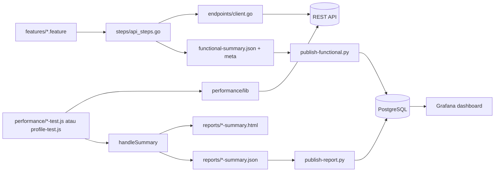
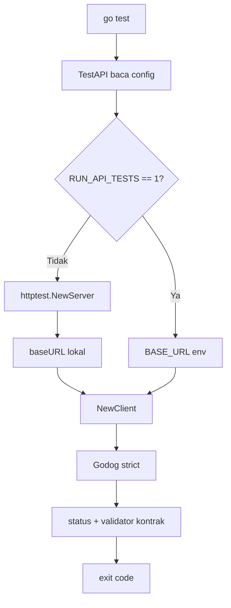
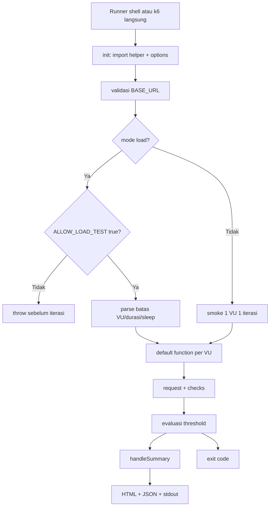
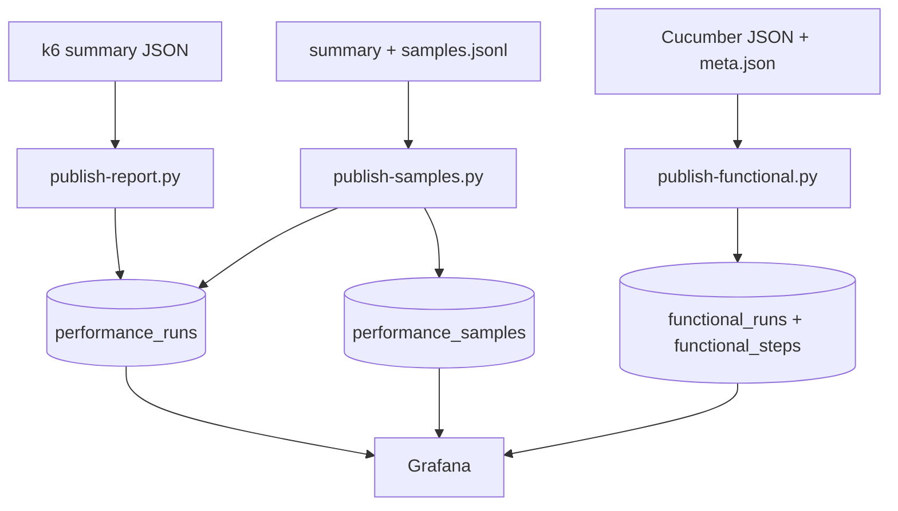

## Tiga jalur independen

Go dan k6 adalah dua runner yang **tidak saling memanggil**. k6 tidak memakai client Go,
dan Go tidak menjalankan k6. Keduanya hanya berbagi kontrak domain dan pipeline report.



| Komponen | Tanggung jawab | Bukan tanggung jawab |
| --- | --- | --- |
| Go + Godog | Kontrak request/response dan status | Latency, beban, kapasitas |
| k6 | HTTP workload, checks, threshold, metrik | Validasi langkah BDD |
| Python publisher | Validasi artefak, SQL, idempotensi | Menjalankan test |
| PostgreSQL | Menyimpan aggregate + step evidence | Database aplikasi |
| Grafana | Visualisasi dan drilldown | Menjalankan testcase |

## Alur Go: mock lokal vs integrasi



- Default **bukan skip**: kedua feature tetap dijalankan lewat HTTP loopback.
- Mock `/auth` hanya menerima POST JSON dengan kredensial lokal yang sesuai; selain itu 400.
- Mock `GET /booking` mengembalikan `[{"bookingid":1}]`; rute/method lain 404.
- Mode integrasi hanya mengganti target dan kredensial — feature, steps, client, dan validator sama.

Detail: [Go + Godog](/functional/go-godog).

## Alur k6



Detail: [Performance k6](/performance/k6) dan [Laporan performance](/performance/laporan).

## Jalur report dan evidence



- **Aggregate setelah run**, bukan streaming.
- ID deterministik: replay byte yang identik tidak menambah row.
- `execution_mode` (`local`/`integration`) selalu ikut disimpan pada data functional.
- p95 antar run tidak boleh dirata-ratakan untuk klaim p95 global.

## Transport Go generik

Selain adapter Booker, tersedia `endpoints.NewHTTPClient` / `Do` untuk API lain:

- Menolak URL non-absolut, non-HTTP(S), userinfo, query, dan fragment.
- Redirect dinonaktifkan (`http.ErrUseLastResponse`).
- Timeout request 15 detik, body disimpan maksimal 1 MiB.
- URL/path tidak aman ditolak; error transport disamarkan.
- **Tidak** menerapkan allowlist origin milik engine k6 — pemanggil menentukan izin target.

```go
client, err := endpoints.NewHTTPClient("http://127.0.0.1:8080/api", nil)
if err != nil {
    return err
}
result, err := client.Do(context.Background(), endpoints.Request{
    Method: http.MethodGet,
    Path:   "/resource",
    Query:  url.Values{"limit": {"1"}},
    Headers: http.Header{"Accept": {"application/json"}},
})
```

## Batas desain yang disengaja

- Dua skenario BDD happy path, bukan seluruh CRUD/negative business contract.
- Validator Go mengizinkan extra fields dan bukan JSON Schema lengkap.
- Engine profil v1 bukan browser automation, bukan DSL Godog universal, bukan distributed load.
- Penanda `secret` adalah label, **bukan** enkripsi atau sanitizer universal.
