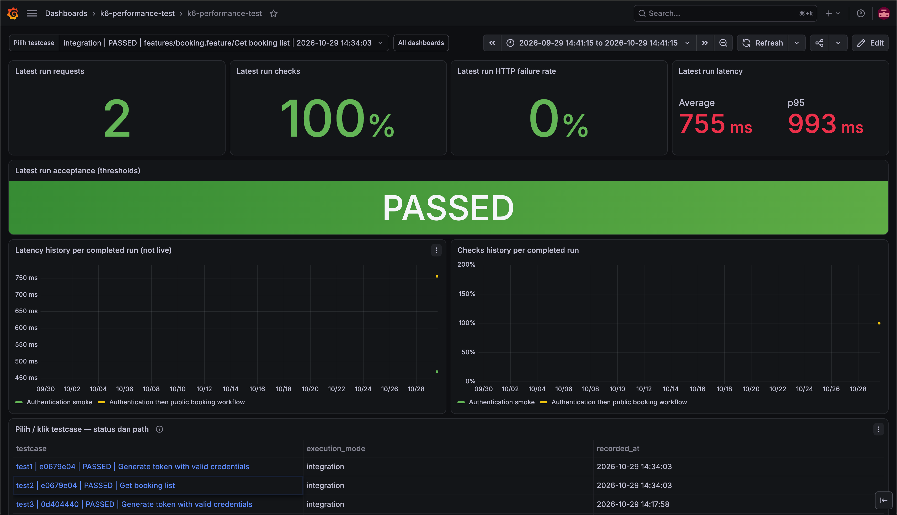
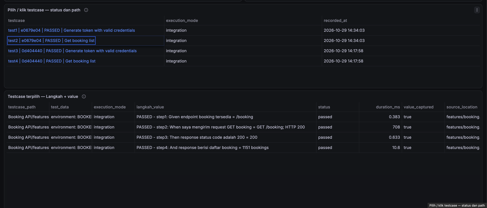

Dashboard UID: **`k6-performance-test`**

`http://katalon-home.orb.local:3005/d/k6-performance-test/k6-performance-test`

Dashboard berada di folder **k6-performance-test**, bukan folder proyek lain. Datasource
PostgreSQL memakai role reader (`k6_report_reader`).

<Frame>
  
</Frame>

## Struktur tampilan

Dashboard disusun dalam **tujuh section** (row) agar tidak memanjang. Dua section sekunder
dilipat secara default.

| Section | Panel | Default |
| --- | --- | --- |
| Pilih / klik testcase | 1 tabel selector | terbuka |
| Performa k6 | 6 grafik, dua kolom | terbuka |
| Ringkasan run terbaru | 4 stat + acceptance | terbuka |
| Detail testcase terpilih | durasi step, pie value, tabel langkah | terbuka |
| Riwayat run | latency/checks history + run history | terbuka |
| Functional evidence | 4 tabel | **collapsed** |
| Sampel per request & diagnostik | 3 panel | **collapsed** |

### 25 panel daun

| # | Panel | Jenis |
| --- | --- | --- |
| 1–4 | Latest run requests, checks, HTTP failure rate, latency | stat |
| 5 | Run history (aggregate reports) | table |
| 6 | Latest run acceptance (thresholds) | stat |
| 7–8 | Latency history, checks history per completed run | timeseries |
| 9 | Functional totals — LOCAL mock vs INTEGRATION | table |
| 10 | Functional run status — execution mode | table |
| 11 | Functional scenarios — LOCAL is not API evidence | table |
| 12 | Functional step trace / sanitized errors | table |
| 13 | Pilih / klik testcase — status dan path | table |
| 14 | Testcase terpilih — Langkah + value | table |
| 15 | HTTP request duration — avg/p95/min/max/median | timeseries |
| 16 | Throughput — HTTP requests/second | timeseries |
| 17 | Iteration rate — iterations/second | timeseries |
| 18 | Data transfer rate — received/sent | timeseries |
| 19 | HTTP timing — waiting/TLS/connecting | timeseries |
| 20 | Request count vs run duration / iteration & byte counts | table |
| 21 | Latest ten actual requests (ordinal → duration) | xychart |
| 22 | Latest ten actual HTTP statuses / durations | table |
| 23 | Testcase terpilih — durasi setiap step | barchart |
| 24 | Testcase terpilih — actual value captured | piechart |
| 25 | Latest sampled run — HTTP status counts | barchart |

Grafik 15–20 adalah **aggregate antar completed run**. Grafik 21 memakai titik request
aktual yang dipublish sesudah run, bukan streaming realtime.

## Selector dan drilldown

- Dropdown **Pilih testcase** atau klik baris pada panel 13.
- Link mengubah `var-testcase` tanpa `viewPanel` → detail tetap di dashboard yang sama.
- Identitas testcase: `run_id` + hash(`uri`, `scenario_line`).
- Label `auto_…` adalah identitas UI, bukan PK database atau ID Godog.
- Rentang waktu Grafana menentukan data yang tersedia.

<Frame>
  
</Frame>

Panel detail menampilkan keyword, teks step, `file:line`, status, durasi, dan value runtime
(mis. `POST /auth; HTTP 200`, `present (redacted)`). Credential dan token tidak pernah
ditampilkan.

## Dua kesalahpahaman umum

<AccordionGroup>
  <Accordion title="Local dianggap bukti API nyata">
    Mode `local` memakai mock `httptest` in-process. Itu bukti logika test, **bukan** bukti
    website/API nyata. Hanya `integration` yang berbicara ke API asli.
  </Accordion>
  <Accordion title="Durasi step disamakan dengan latency HTTP">
    Durasi step functional adalah waktu langkah Godog. Latency HTTP adalah metrik k6.
    Keduanya tidak digabung dalam satu execution ID.
  </Accordion>
  <Accordion title="Panel kosong dianggap lulus">
    Panel kosong berarti belum ada record pada rentang waktu terpilih, bukan test passed.
  </Accordion>
  <Accordion title="Latest panel disangka selalu auth">
    Latest = run terbaru **dalam rentang waktu**; bisa workflow booking. Persempit rentang
    atau lihat histori.
  </Accordion>
</AccordionGroup>

## Mengubah dashboard dengan aman

Sumber kebenaran adalah `observability/dashboard.json`.

1. Edit file JSON (bukan hanya UI).
2. Validasi struktur dan query:
   ```bash
   python3 -m json.tool observability/dashboard.json > /dev/null
   python3 scripts/test-dashboard.py
   python3 scripts/check-workspace.py
   ```
3. Import ulang lewat mekanisme deployment yang disetujui (mis. `setup-observability.py`
   atau Grafana API `POST /api/dashboards/db` dengan `overwrite: true`).
4. Uji query panel pada rentang waktu nyata.

<Warning>
Jangan mengedit dashboard produksi tanpa mengekspor perubahan ke file. Jangan mengubah
schema/dashboard remote tanpa persetujuan.
</Warning>

Panduan query dan interpretasi: [Publishing](/observability/publishing) dan
[Skema PostgreSQL](/observability/skema-postgres).
