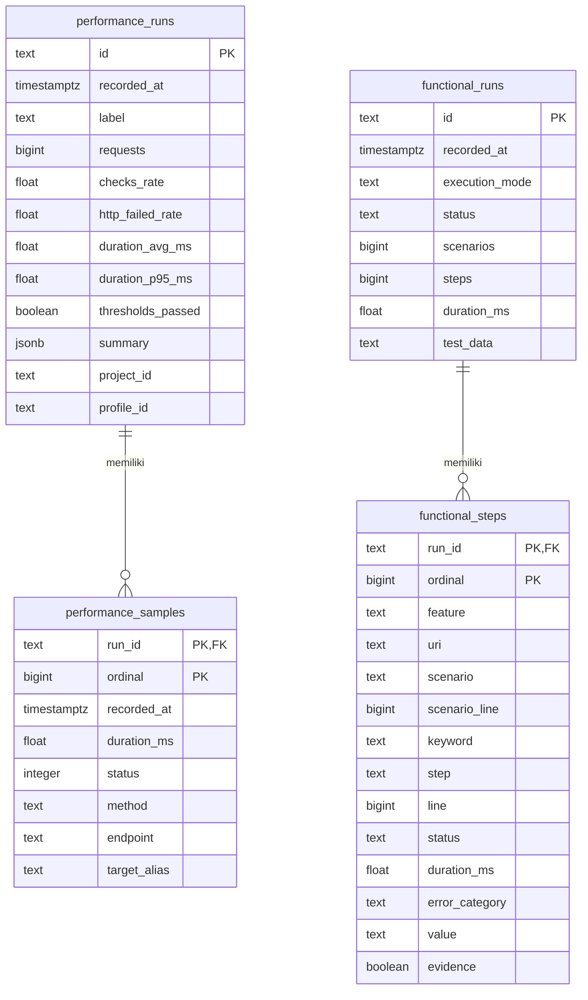

Database: **`k6-performance-test`** (dedicated, terpisah dari database aplikasi).
Sumber kebenaran: `observability/schema.sql`.

## Model data



## `performance_runs`

Satu row per report aggregate.

| Kolom | Catatan |
| --- | --- |
| `id` | UUID v5 deterministik dari hash byte report. |
| `recorded_at` | Timestamp berzona dari report. |
| `label` | Judul test (1–255 karakter, tanpa control char). |
| `requests` | Total HTTP request. |
| `checks_rate`, `http_failed_rate` | Pecahan 0–1. |
| `duration_avg_ms`, `duration_p95_ms` | Milidetik. |
| `thresholds_passed` | Semua threshold dievaluasi sukses. |
| `summary` | JSONB aggregate asli — bukan response API/token. |
| `project_id`, `profile_id` | Metadata publik (default `restful-booker` / `legacy`). |

## `performance_samples`

Titik request individual hasil allowlist engine.

| Kolom | Catatan |
| --- | --- |
| `run_id`, `ordinal` | PK gabungan; ordinal > 0. |
| `duration_ms` | ≥ 0; nol valid untuk transport failure. |
| `status` | `0` (transport failure) atau 100–599. |
| `method`, `endpoint` | Booker: `POST /auth` / `GET /booking`; universal: `op:<request-id>`. |
| `target_alias` | Alias target, bukan URL. |

URL, query, tag mentah, dan body tidak pernah disimpan.

## `functional_runs`

| Kolom | Catatan |
| --- | --- |
| `id` | SHA-256 hex 64 karakter dari byte report + metadata. |
| `execution_mode` | `local` atau `integration`. |
| `status` | `passed` hanya bila semua step passed. |
| `scenarios`, `steps` | Harus > 0. |
| `duration_ms` | Jumlah durasi step, bukan wall-clock suite. |
| `test_data` | Deskripsi sumber data, bukan credential. |

## `functional_steps`

| Kolom | Catatan |
| --- | --- |
| `run_id`, `ordinal` | PK gabungan. |
| `feature`, `uri`, `scenario`, `scenario_line` | Sumber skenario. |
| `keyword`, `step`, `line` | Detail langkah. |
| `status` | passed/failed/undefined/pending/skipped/ambiguous. |
| `duration_ms` | Nanodetik Godog ÷ 1.000.000. |
| `error_category` | `none` atau kategori status; bukan pesan server. |
| `value`, `evidence` | Observasi aman dan status capture. |

## Identitas dan idempotensi

- Performance: ID UUID v5 dari hash byte; replay byte identik → `ON CONFLICT DO NOTHING`.
- Functional: ID SHA-256 dari report + metadata; pasangan identik idempoten.
- Mengubah formatting JSON mengubah hash → row baru.
- Ini bukan autentikasi provenance; metadata adalah label eksekusi.

## Constraint penting

- `performance_runs.id` harus UUID v5 valid.
- `duration_*` finite dan ≥ 0.
- `checks_rate`/`http_failed_rate` di 0–1.
- `functional_steps.status` dibatasi enum.
- Endpoint sample legacy dibatasi; constraint generated diganti hanya setelah definisinya
  diperiksa.

## Query diagnosis

```sql
-- Run terbaru
SELECT recorded_at, label, requests, checks_rate, thresholds_passed
FROM public.performance_runs
ORDER BY recorded_at DESC
LIMIT 10;

-- Detail testcase
SELECT r.recorded_at, s.scenario, s.keyword, s.step,
       s.value, s.evidence, s.status, s.duration_ms, s.error_category
FROM public.functional_steps s
JOIN public.functional_runs r ON r.id = s.run_id
ORDER BY r.recorded_at DESC, s.ordinal
LIMIT 50;

-- Titik per request
SELECT ordinal AS request_index, duration_ms, status
FROM public.performance_samples
WHERE run_id = '<selected-run-id>'
ORDER BY ordinal;
```

Hasil kosong dapat berarti belum publish, rentang waktu salah, atau filter testcase —
bukan otomatis test gagal.

<Warning>
Jangan merata-ratakan p95 beberapa run untuk mengklaim p95 global. Agregat per run tidak
setara distribusi mentah.
</Warning>
