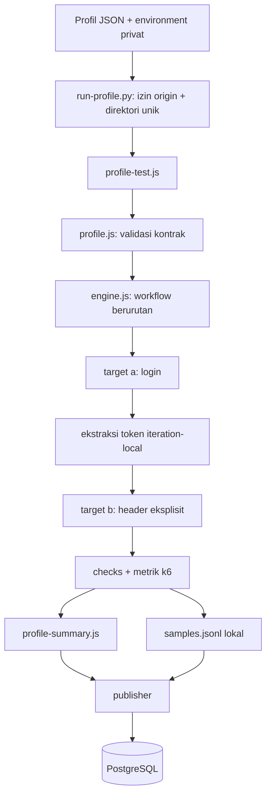

## Konsep

Engine memisahkan **konfigurasi** (profil JSON) dari **transport, assertion, ekstraksi, dan
reporting**. Mengganti website/API berarti mengubah profil, bukan menyalin engine.



<Info>
Sasaran v1 adalah **HTTP API**, bukan klik browser/DOM, bukan DSL Godog universal.
Multipart/upload, branching kompleks, plugin/eval, streaming, dan distributed load tidak
termasuk.
</Info>

## Menjalankan

```bash
# Dua website tanpa login
export WEB_A_ORIGIN=https://web-a.example
export WEB_B_ORIGIN=https://web-b.example
python3 scripts/run-profile.py performance/profiles/multi-web-smoke.json \
  --allow-origin https://web-a.example --allow-origin https://web-b.example
```

```powershell
$env:WEB_A_ORIGIN = 'https://web-a.example'
$env:WEB_B_ORIGIN = 'https://web-b.example'
python3 scripts/run-profile.py performance/profiles/multi-web-smoke.json `
  --allow-origin https://web-a.example --allow-origin https://web-b.example
```

Contoh yang tersedia:

| Profil | Kegunaan |
| --- | --- |
| `performance/profiles/booker-example.json` | Contoh domain Booker. |
| `performance/profiles/multi-web-smoke.json` | Dua halaman HTML, tanpa kredensial. |
| `performance/profiles/multi-target-example.json` | Login di target `a`, pakai token ke target `b`. |

`multi-target-example.json` mengambil `/token` dari `POST /login` di `a`, lalu mengirim
`Authorization: Bearer {{token}}` **secara eksplisit** ke `GET /resource` di `b`, dan
memeriksa `/ok == true`. Token tidak otomatis menjadi header request lain.

## Wrapper portable

`scripts/run-profile.py PROFILE.json [--allow-origin ORIGIN]... [--output-dir DIR]`

- Tidak memuat `.env` dan tidak menjalankan shell.
- Menolak environment `K6_*` selain `K6_NO_USAGE_REPORT` (yang dipaksa `true`).
- Membuat direktori run baru; `--output-dir` existing ditolak.
- Menetapkan `PERF_PROFILE` absolut dan `PERF_RUN_ID` 32-hex baru.
- Batas ukuran profil 256 KiB.
- Exit code k6 diteruskan; kegagalan validasi/prasyarat wrapper = `2`.

```text
reports/profiles/<project>/<id>/<UTC-time>-<random-id>/
  console.txt
  samples.jsonl
  reports/profile-<id>-summary.json
  reports/profile-<id>-summary.html
```

## Batas workload

| Mode | Batas |
| --- | --- |
| `smoke` | `vus:1`, `iterations:1`, tanpa `durationSeconds`, pause 0–60 detik |
| `sample` | `vus:1`, iterations 1–10, **pauseSeconds 1–60** |
| `load` | `ALLOW_LOAD_TEST=true`, vus 1–10, durationSeconds 1–300, tanpa iterations |

- Tiap workflow 1–10 request.
- Smoke/sample maksimal 100 request terkonfigurasi.
- Load memakai `constant-vus` dengan `gracefulStop` 15 detik.
- Guard bukan sandbox: direct `k6` atau perubahan kode tetap dapat melewatinya, sehingga
  kebijakan izin tetap diperlukan.

## Keamanan origin

- Origin harus literal canonical `http://host[:port]` atau `https://host[:port]`, tanpa
  path, slash akhir, query, fragment, whitespace, atau userinfo.
- Pencocokan allowlist **persis string** — bukan wildcard/subdomain/normalisasi port.
- HTTP non-loopback memerlukan `PERF_ALLOW_HTTP=true` (opt-in transport tidak terenkripsi).
- Redirect dinonaktifkan; timeout request 15 detik; verifikasi TLS tetap aktif.
- Allowlist adalah pagar teknis, **bukan** izin dari pemilik target dan bukan CORS browser.

## Batas respons

Request yang hanya mengecek status/latency memakai `responseType: none`. Assertion/ekstraksi
JSON membutuhkan body text; sebelum `JSON.parse`, engine menolak string lebih dari
**1.048.576 code units**. Ini membatasi overhead parsing, bukan hard cap unduhan body.

## Artefak dan publikasi

Summary berisi project/profile publik, timestamp, `execution_id`, `mapping_fingerprint`,
dan metrik whitelist numerik. Tidak berisi origin, path, header, token, atau body.

```bash
python3 scripts/publish-report.py RUN_DIR/reports/profile-<id>-summary.json
python3 scripts/publish-samples.py RUN_DIR/reports/profile-<id>-summary.json \
  RUN_DIR/samples.jsonl --profile performance/profiles/multi-target-example.json
```

Fingerprint hanya menghitung mapping operasi publik (project/profile + urutan request
ID/target alias/method) — **bukan** hash konfigurasi privat dan bukan bukti kriptografis
eksekusi tepercaya.

<Warning>
Migrasi kolom (`project_id`, `profile_id`, `target_alias`) wajib diterapkan sebelum
menjalankan publisher baru pada database lama. Lihat [Setup](/observability/setup).
</Warning>

## Verifikasi offline

```bash
node scripts/test-profile.mjs
python3 scripts/test-profile-k6.py        # butuh k6 + dua fixture loopback
python3 scripts/test-report-profiles.py
```

Kontrak field lengkap: [Referensi profil](/performance/referensi-profil).
